# Hata

[English](README.md) · **Українська**

Домашній сервер одним файлом: веб-панель, магазин Docker-застосунків, файли, HTTPS і резервні копії.
(«Hata» — це «хата».)

Один процес, один бінарний файл, без мікросервісів, без сервера бази даних поруч і без npm-пакетів —
на Bun, без жодної залежності. Застосунок — це звичайний compose-файл на диску: Hata не ховає Docker.

```sh
curl -fsSL https://raw.githubusercontent.com/sanyadez/hata/main/install.sh | sudo sh
```

На машині з Linux і systemd, x86_64 або arm64 — див. [Встановлення](#встановлення).


| | |
|---|---|
|  Магазин застосунків |  Сторінка застосунку |
|  Налаштування застосунку формою |  Файли |
|  Копії |  На телефоні |

Усі сторінки й усі варіанти вигляду: [Знімки екрана](#знімки-екрана).

## Запитання й відповіді

**Що вона робить?**
Перетворює машину з Linux — старий комп'ютер, міні-ПК, Raspberry Pi, віртуальну машину — на домашній
сервер, яким керують із браузера, а не з термінала. Ви обираєте застосунок у магазині (Jellyfin,
Nextcloud, Home Assistant, Pi-hole і ще значно більше сотні інших), натискаєте «Встановити» — і він працює
в Docker. Навколо застосунків Hata робить решту того, що потрібно домашньому серверу: головна сторінка зі
станом машини, файловий менеджер, теки, відкриті в мережі, диски, їхнє здоров'я й захист від відмови диска,
резервні копії з відновленням усього застосунку чи окремих файлів, мережа самого сервера — Wi-Fi, запасний
шлях до інтернету, точка доступу, — користувачі й те, кому що можна відкривати, HTTPS, сповіщення, коли
щось ламається. Вона також доглядає інші комп'ютери дому через невеликий клієнт, створює контейнери й віртуальні машини
на самому сервері, доглядає ті, що на сервері Proxmox VE, і виводить пристрої сервера Home Assistant на
свою головну сторінку. Повний перелік — у розділі [Стан](#стан).

**Аналог чого це?**
Програм домашнього сервера того ж роду: Umbrel, Runtipi, Cosmos. На відміну від деяких із
них, це не операційна система: це одна програма, яку ставлять на той Linux, що вже є, і так само легко
з нього прибирають. Що є в кожної з них — [Hata поруч з іншими](COMPARISON.uk.md).

**Чим вона краща за Cockpit?**
Не краща — вона для іншого. Cockpit адмініструє сервер на Linux: сервіси systemd, журнал, мережеві
інтерфейси, системні облікові записи, пакети, віртуальні машини. Hata — про застосунки й про людей у
домі: магазин, встановлення одним натисканням, головна сторінка з плитками, копії даних застосунків,
члени родини, які відкривають свої застосунки й більше нічого. У Cockpit немає магазину застосунків і
поняття «застосунок із його даними»; Hata не керує сервісами systemd чи системними обліковими записами.
Із системи вона бере те, що потрібно домашньому серверу: пакети оновлюються зі сторінки — і сервера, і
інших машин, — сервер перезавантажується чи вимикається, а контейнери й віртуальні машини створюються на
самому сервері або на сервері Proxmox VE. З мережі вона робить те, що потрібно домашньому
серверу: показує інтерфейси й змінює адресу — IPv4 та IPv6, — а якщо до сервера більше не дістатись,
попередня повертається сама; під'єднується до Wi-Fi, тримає USB-модем запасним шляхом до інтернету й може
зробити з адаптера Wi-Fi точку доступу. Одне одному вони не заважають і можуть працювати на одній машині.

**Чи може вона керувати контейнерами й compose-файлами, як Portainer?**
Застосунками — так. Кожен застосунок — це compose-проєкт, і на його сторінці ви запускаєте, зупиняєте й
перезапускаєте його, оновлюєте образи, бачите процесор і пам'ять кожного контейнера, читаєте журнал наживо,
відкриваєте оболонку всередині контейнера й редагуєте compose-файл — текстом або формою. Можна вставити
будь-який compose-файл чи команду `docker run`, щоб зробити застосунок, а те, що вже працює на машині
(compose-проєкти, запущені деінде, окремі контейнери), можна забрати як застосунки. «Налаштування → Docker»
показує образи й томи з їхнім розміром і тим, хто ними користується, і прибирає ті, що нікому не потрібні, —
на сервері й на кожній під'єднаній до нього машині, де застосунками, контейнерами й compose-файлами
керують так само. Чого в Hata немає — це решти погляду Portainer на Docker: мереж, Swarm, Kubernetes,
образів, зібраних із Dockerfile. Portainer чудово працює поруч — як застосунок із магазину.

**Чи перевіряє вона реєстри Docker на новіші образи?**
Так. Раз на добу Hata питає реєстри, чи теги, якими користуються ваші застосунки, — скажімо, `latest` —
вказують на новіші образи, ніж ті, що працюють; для цього нічого не завантажується. Застосунок із
новішим образом дістає позначку на плитці, а на його сторінці підсвічується «Оновити образи».
Оновлювати чи ні — вирішуєте ви, доки не ввімкнете «Оновлювати застосунки самостійно» в
«Налаштування → Застосунки»: тоді запущені застосунки з новішими образами оновлюються щодня у вказаний
час, перед цим робиться знімок даних застосунку, і будь-який застосунок можна з цього вилучити. Hata
також помічає, коли новіша версія застосунку з'являється в магазині. Образи беруться з будь-якого
реєстру, названого в compose-файлі; вхід, збережений через `docker login`, використовується, а входу до
приватного реєстру в інтерфейсі немає.

## Стан

Рання розробка. Що працює сьогодні:

- встановлення одним рядком: один бінарний файл, який сам налаштовує себе як сервіс systemd;
- переїзд із CasaOS одним рядком: її застосунки переймаються там, де вони є, і все можна повернути;
- перший запуск створює адміністратора — типових облікових даних немає, а для налаштування потрібен код,
  який показує лише консоль сервера; далі сервер проводить через перші рішення: його назва, що вже
  працює на машині, де лежатимуть дані й копії, кілька застосунків для початку;
- головна сторінка: процесор, пам'ять, диск, мережа й температура з історією, плитки застосунків зі станом
  наживо, список «Потребує уваги» (застосунок, що раз у раз перезапускається, невдале встановлення чи
  оновлення, диск, що заповнюється) і останні події; пункт у тому списку має кнопку, що розв'язує
  справу, — оновити, перезапустити, спробувати знову, підключити знову, розбудити машину, — і його можна
  відкласти на три дні («Нагадати через 3 дні»), а якщо стане гірше, він повернеться одразу;
- головну сторінку ви впорядковуєте самі: звичайні посилання поруч із застосунками, названі групи, теки
  плиток, що відкриваються на місці, як на телефоні, — усе перетягуванням, мишею чи пальцем, без окремого
  режиму редагування; групи й блоки сторінки (показники системи, що потребує уваги, події) теж
  перетягуються, їх можна прибрати й повернути; усю розкладку можна редагувати і як текст (YAML); плитка
  відкриває застосунок, її меню (кнопка поруч або правий клік) запускає, зупиняє й перезапускає його
  і веде до його налаштувань, журналу, термінала й копій. Правий клік усюди відкриває власне меню Hata —
  на плитці, файлі, рядку таблиці — з тим, що можна зробити з тим, на чому клацнули;
- ім'я в домашній мережі: Hata відповідає на `hata.local`, а кожен застосунок — на `<застосунок>.hata.local`
  через multicast DNS — нічого не треба налаштовувати на телефонах, комп'ютерах чи роутері; ім'я можна
  змінити, а ім'я з іншим закінченням (`hata.lan`) теж працює, щойно його знає DNS вашого роутера;
- термінал у браузері, для адміністраторів: оболонка на сервері (вона працює далі, коли сторінку закрито, і
  показує останній вивід, коли ви повертаєтесь) та оболонка всередині контейнера застосунку;
- вигляд теж ваш: колір акценту й тла (світле тло робить світлою всю сторінку), фонове зображення — одне з
  вбудованих або власне;
- магазин застосунків: [Hata Store](https://github.com/sanyadez/hata-store) — кожен застосунок є звичайним
  compose-файлом, що працює й без Hata, з описом, налаштуваннями й тим, чого він просить від сервера, — це
  видно до встановлення; налаштування йдуть у `.env` застосунку, зайнятий порт замінюється вільним, паролі
  створюються; інші магазини додаються за адресою; пошук і категорії, встановлення з перебігом наживо;
- власні застосунки: заповніть форму або вставте будь-який compose-файл;
- імпорт того, що вже працює: compose-проєкт, запущений деінде, стає застосунком без перезапуску;
  контейнер, запущений через `docker run`, перебудовується в застосунок із compose-файлу, написаного з його
  налаштувань (його показано і його можна змінити, перш ніж щось станеться), на тих самих томах, а якщо
  новий контейнер не піднявся — старий повертається на місце;
- оновлення з магазину, які зберігають ваші зміни: коли в магазині є новіша версія застосунку, Hata
  показує, що змінюється в його compose-файлі, і вливає це — ваші порти, теки, змінні й правки вручну
  лишаються, а де ви й магазин змінили той самий рядок, перемагає ваш, і різницю показано;
- Docker (Налаштування → Docker): образи й томи з їхнім розміром і застосунками та контейнерами, що ними
  користуються; непотрібний прибирається одним натисканням, а можна й усі разом, кеш збирання
  очищується — на сервері й на кожній машині;
- оновлення системи: пакети системи, для яких є новіші версії (оновлення безпеки позначено), і чи чекає
  сервер на перезавантаження — перевіряється щодня, оновлюється все разом або на вибір, — на сервері й
  на кожній машині; сервер перезавантажується чи вимикається зі сторінки;
- мережа: інтерфейси сервера з адресою, шлюзом і DNS; адреса змінюється зі сторінки — стала або від
  роутера — через NetworkManager (встановлюється на прохання, інтерфейс, який налаштувала система,
  передається таким, як є), і кожна зміна на випробуванні: якщо сторінка не дістанеться до сервера
  знову за півтори хвилини, попередні налаштування повернуться самі; Wi-Fi: мережі поблизу,
  під'єднання з паролем, «забути» мережу; USB-модем або телефон, що роздає з'єднання, розпізнається,
  і ви обираєте, який інтерфейс — основний шлях до інтернету, а який запасний; адаптер Wi-Fi може
  стати власною точкою доступу сервера — під'єднання за QR-кодом, інтернет роздається через сервер, а
  мережу, канал і адресу обираєте ви, — і так само інтернет можна роздати через вільний кабельний порт;
  IPv6 налаштовується поруч з IPv4 (від роутера, стала адреса або вимкнено), до мережі Wi-Fi з
  прихованою назвою можна під'єднатися, ввівши її, а інтерфейс, переданий NetworkManager, можна повернути;
  за бажанням кожен шлях перевіряється щохвилини, і запасний підхоплює, доки в основному немає
  інтернету, а шлях без інтернету з'являється в «Потребує уваги»; інтерфейс, яким приходить
  інтернет (кабель провайдера просто в сервері), позначається як бік інтернету, і там сервер нічого не
  показує — ні сторінок, ні застосунків із портами Docker, ні мережевих тек, — а на інтерфейс із
  публічною адресою, не позначений так, Hata вказує сама;
- новіші образи: раз на добу реєстри питаються, чи теги ваших застосунків вказують на новіше, і
  застосунок із новішим образом дістає позначку; за бажанням запущені застосунки оновлюються самі у
  вказаний час, кожен після знімка своїх даних;
- для кожного застосунку, на його сторінці: запуск, зупинка, перезапуск, оновлення образів, процесор і
  пам'ять кожного контейнера, журнал наживо, редагування compose-файлу, видалення з даними або без;
- налаштування застосунку формою: образ, назва й значок, адреса веб-інтерфейсу, мережа,
  порти, томи, змінні середовища, пристрої, команда, привілеї, обмеження пам'яті, частка процесора,
  правило перезапуску, capabilities, ім'я хоста — для кожного сервісу застосунку, а сервіси додаються й
  прибираються як вкладки. Форма редагує той самий compose-файл: чого вона не показує, лишається як
  написано. Власний застосунок можна описати цією формою замість compose-файлу, а форму — заповнити з
  команди `docker run`, вставленої з інструкції до застосунку. Значком застосунку може бути ваше
  зображення: воно лежить поруч із compose-файлом як `icon.*` і використовується замість значка з магазину;
- резервні копії: знімок застосунку (compose-файл, його теки, його томи Docker) звичайним `tar.gz`,
  щодня за розкладом і перед кожним оновленням, відновлення до будь-якого знімка — також застосунку, який
  уже видалено; теки, якими застосунок користується поза власними (медіа, документи), потрапляють у
  знімок, коли ви їх оберете; у знімок можна зазирнути як на диск, дістати з нього файл і повернути
  окремі файли й теки, не відновлюючи весь застосунок; про копіювання за розкладом можна отримувати
  сповіщення;
- копія всього сервера: з кожним запуском копіювання власний стан Hata (налаштування, користувачі, головна
  сторінка, compose-файли застосунків) зберігається поруч зі знімками застосунків, а
  `sudo hata restore <тека копій>` на новій машині повертає Hata, а тоді кожен застосунок із його
  останнього знімка;
- друга копія в іншому місці: кожен знімок надсилається через SFTP на NAS, орендоване сховище чи інший
  сервер — із ключем, який Hata створює собі сама, ніколи не з паролем, — або в бакет S3-сумісного
  сховища (Backblaze B2, Wasabi, Cloudflare R2, Amazon S3, MinIO), частинами, тож великий знімок не
  забирає пам'яті. Із парольною фразою файли шифруються до того, як залишать сервер, тож той, хто їх
  зберігає, прочитати їх не може. День, коли інша машина
  була вимкнена, надолужується наступного разу, а копія, що відстає, з'являється в «Потребує уваги».
  `hata restore` відкриває таку копію, якщо дати парольну фразу, і приймає адресу самої копії —
  `s3://бакет/тека` чи `sftp://користувач@хост/тека` — та сам завантажує останні знімки;
- диски та їхнє здоров'я (Налаштування → Сховище): кожен диск із тим, що він каже про себе (SMART),
  простими словами — здоровий, зношується чи виходить із ладу, і чому, — його температура, наскільки він
  заповнений і де змонтований; файлові системи сервера, разом із мережевими теками. Здоров'я читається
  кожні пів години, не будячи диск, що спить; диск із проблемою з'являється в «Потребує уваги» й
  надсилається сповіщенням, а диску можна сказати перевірити себе. Важливі лічильники запам'ятовуються:
  сторінка диска каже «було 0 до 14 вер.», а лічильник, що росте, надсилається сповіщенням знову. Для
  цього потрібен `smartmontools`, який Hata пропонує встановити; на диску нічого не змінюється;
- взяти диск у роботу (та сама сторінка): диск форматується в одному діалозі — один розділ, ext4, тека
  в `/mnt`, рядок у `/etc/fstab`, який не затримує запуск, коли диска немає (Docker чекає на диск, а без
  нього застосунки, що тримають там дані, лишаються зупиненими, а не стартують порожніми на системному
  диску — головна сторінка каже, якого диска бракує); диск, на якому вже є файли (ext4, XFS, Btrfs, FAT,
  exFAT, NTFS), підключається як є, нічого на ньому не змінюється; USB-диск може підключатися сам, коли
  його вставлено, а перед тим, як його вийняти, його безпечно відключають. Про диск, яким ще ніщо не
  користується, сказано й на головній сторінці, а вміст вставленої флешки можна скопіювати на сервер —
  увесь або вибрані теки й файли, у теку, яку ви оберете. Стирання питає ім'я диска й ваш пароль і ніколи не
  пропонується для системного диска, диска, що використовується, чи учасника масиву;
- форматування й для інших пристроїв: диск, флешка чи окремий розділ стає ext4, Btrfs, XFS, exFAT, FAT32 або NTFS
  із міткою, яку ви введете, з таблицею розділів і типом, яких чекає кожен вид пристроїв, і далі
  лишається підключеним, підключеним до виймання або готовим, щоб його забрати, — флешку, яку
  підключила Hata, вона для цього сама відключає. Файлову систему можна
  перевірити й полагодити (те, що лишає виймання без відключення, зокрема позначку NTFS, через яку диск
  не підключається) і перейменувати. Розділ може бути меншим за диск, а в місці, що лишилось, згодом
  робиться ще один; розділ збільшується чи зменшується (разом із його файловою системою) або видаляється; диск, який іде до когось іншого, стирається — за бажанням із перезаписом кожного
  блоку. Довгі операції показують, що кажуть програми й скільки вже зроблено, а про диск даних, який
  заповнюється, сказано за місяць наперед;
- тека даних переноситься на диск однією кнопкою (Налаштування → Застосунки або одразу після форматування
  диска): застосунки зупиняються, усе копіюється, compose-файли застосунків — разом із коментарями, —
  копії, спільні теки й теки на головній сторінці спрямовуються на нове місце, і застосунки запускаються
  знову; стара тека лишається, доки ви її не видалите, а знімок, зроблений до перенесення, і далі
  відновлюється;
- кілька дисків як одна тека (mergerfs, встановлюється на запит): новий файл іде на диск, де найбільше
  вільного місця, кожен файл лишається звичайним файлом на одному з дисків. Вставлений диск сам
  з'являється на сторінці, а диски є в бічній панелі Файлів. «Кілька дисків разом» налаштовує диски за
  один раз — для чого, які диски, на якому з них парність — з одним підтвердженням для всього, що буде
  стерто; коли диск, на якому застосунки тримають дані, повертається після відсутності, застосунки, які
  через це зупинилися, самі запускаються знову;
- захист від відмови диска (SnapRAID, встановлюється на запит): один диск зберігає парність для
  решти — або два, і тоді можуть відмовити будь-які два диски разом, — диски лишаються звичайними
  дисками; синхронізація щоночі й перевірка щотижня; коли диск виходить з ладу, новий на його місці
  заповнюється з парності; файли, помилково видалені після останньої синхронізації, повертаються так
  само — усі або один, знайдений за іменем, — а синхронізація, після якої забулося б забагато файлів,
  чекає на ваше слово; пошкодження, знайдені перевіркою, лагодяться з парності;
- масиви й пули, які в системі вже є, — Linux RAID (mdadm), ZFS, Btrfs на кількох дисках — на тій самій
  сторінці: їхній стан, диски, ресинхронізація чи відбудова з тим, скільки зроблено, і їхня власна
  перевірка (scrub), яку звідти запускають і зупиняють; диск, що відмовив чи зник, пошкодження,
  знайдені перевіркою, і помилки диска з'являються в «Потребує уваги». Hata не створює масивів і не
  змінює їх;
- що займає теку даних (та сама сторінка): вимірюється раз на день — її теки, дані кожного застосунку,
  кошик — із тим, наскільки кожне виросло за тиждень, скільки з нього не змінювалося три місяці,
  найбільшими файлами й застосунками, що користуються текою, і, коли диск заповнюється, за скільки він
  буде повний такими темпами;
- теки, відкриті в мережі (Налаштування → Мережеві теки або меню теки у Файлах): тека сервера відкривається
  в Провіднику, Finder чи файловому менеджері телефона як мережевий диск (SMB). Люди підключаються з тим
  іменем і паролем, з якими входять у Hata; для кожної теки кожен користувач може дивитися, змінювати або
  нічого — і так само «будь-хто без пароля». Те, що туди потрапляє, отримує власника своєї теки, тож
  застосунки й далі мають до нього доступ. Роздає Samba: її ставить інсталятор, а Hata налаштовує її
  повністю — `smb.conf`, який там був, зберігається поруч і повертається, коли Hata видаляють. Samba, що
  зупинилася, чи відкрита тека, диск якої зник, з'являється в «Потребує уваги». Адресу
  вводити не треба: поки щось відкрито, сервер сам з'являється в «Мережі» Провідника Windows, у бічній
  панелі Finder і в застосунку «Файли» на телефоні, під своїм іменем у домашній мережі.
  Тека може приймати резервні копії Time Machine з Mac, з обмеженням розміру, а користувачеві можна
  взагалі заборонити мережеві теки;
- мережеві місця: тека NAS, іншого комп'ютера чи сервера деінде — через SMB, NFS, SFTP, WebDAV
  або FTP — монтується тут звичайною текою в `/mnt/net`, тож вона є у Файлах, у кожному виборі теки, і нею
  можуть користуватися застосунки й копії. Її спершу випробовують, а тоді зберігають (хибний пароль чи
  відсутню теку сказано словами самого сервера), вона повертається сама після перезапуску або коли сервер
  знову доступний, а та, що перестала відповідати, з'являється в «Потребує уваги». Сервери, що оголошують
  себе в домашній мережі, перелічено, як і теки, які відкриває сервер;
- файли: файли сервера в браузері, що відкриваються в теці даних і сягають усюди — «Моя хата» з текою
  даних, дисками, мережевими місцями, обраним і машинами на одній сторінці, адресний рядок із кнопками
  «назад» і «вперед», що стає полем, де теки пропонуються, поки ви вводите, клавіатура, як у файловому
  менеджері на комп'ютері, плитки, що показують перші рядки текстового файла, — теки, завантаження
  перетягуванням (також цілих тек, великих файлів частинами), скачування файла чи теки ZIP-архівом,
  перейменування, переміщення, копіювання, видалення — у кошик, звідки річ можна повернути протягом
  30 днів, — копіювання шляху, тека на головній сторінці, меню на правий клік (файла, усього виділеного, теки), інші диски сервера
  вгорі теки даних і в кожному виборі теки, зображення, відео й звук, що відкриваються на
  місці, текстові файли, що створюються й редагуються на місці, ZIP- і tar-архіви, що розпаковуються в
  теку поруч, пошук файлів за назвою в теці, де ви є; що перейменовано, переміщено, скопійовано,
  видалено чи розпаковано, видно в журналі подій. Те, що завантажено в теку застосунку, належить тому
  самому користувачеві, від імені якого працює застосунок; системні теки не видалити випадковим рухом.
  Учасники бачать у Файлах теки, відкриті їм, кожну — щоб дивитися чи змінювати (ті самі права, що й
  через мережу), і так само їм можна відкрити теки машини;
- користувачі: адміністратори, учасники (які бачать застосунки й відкривають їх, більше нічого) і спільні
  гостьові облікові записи; запрошення посиланням; двофакторний вхід із застосунком-автентифікатором і
  кодами відновлення; ключі доступу (passkeys — вхід відбитком, обличчям чи PIN-кодом пристрою), коли Hata
  відкривають за доменом через HTTPS; правило, що кожен адміністратор входить із другим фактором; список
  власних сеансів із виходом на кожному пристрої; журнал входів;
- вхід перед будь-яким застосунком: Hata забирає порт застосунку й пропускає лише тих, хто увійшов у Hata і
  кому дозволено відкривати цей застосунок, — не потрібні ні домен, ні HTTPS, адреса застосунку лишається
  та сама, — і каже застосунку, хто прийшов (`Remote-User` тощо), тож застосунок, який це читає, теж
  впускає їх під їхнім іменем. Інші опубліковані порти застосунку перелічено поруч, і їх можна сховати за
  тим самим входом, якщо це теж веб-сторінки;
- віддалений доступ, три способи на одній сторінці, і жодного немає, доки не натиснуто його кнопку:
  WireGuard для ваших власних пристроїв (Hata робить ключі й дає кожному телефону QR-код, а кожному
  комп'ютеру файл; пристрій бачить лише сервер або й домашню мережу, якщо ви дозволите), WireGuard
  назовні — до вашого сервера деінде за конфігурацією, яку він дав, — і Tailscale для дому за NAT
  провайдера;
- інші машини дому — комп'ютер, віртуальна машина, контейнер із Linux — під доглядом Hata: один рядок,
  виконаний там, встановлює невеликий клієнт, що сам підключається до Hata (на машині не треба
  відкривати порт, з'єднання зашифроване від краю до краю навіть через звичайний HTTP), і машина
  показує свій стан, свої контейнери Docker, згруповані за compose-проєктами (запуск, зупинка,
  перезапуск, журнал, оболонка всередині), і власний термінал. Її файли — у Файлах Hata поруч із файлами
  сервера: переглядати, редагувати, завантажувати й скачувати, копіювати чи переносити теки між сервером
  і машинами. Застосунки з магазину встановлюються на машину так само, як на сервер, їхні плитки — на
  головній сторінці, а застосунок переїжджає із сервера на машину й назад разом зі своїми даними. Їхні
  знімки зберігаються на сервері разом з іншими, входять у щоденне копіювання й звідти ж повертаються.
  Машину можна перезавантажити чи вимкнути з Hata і розбудити знову (Wake-on-LAN). Hata тримає клієнти
  на своїй версії;
- сервери Proxmox VE — за токеном API або одним входом із паролем (тоді Hata сама робить токен лише з
  обраними правами): вузли з їхнім навантаженням і версіями, гості з живленням, налаштуваннями, знімками,
  копіями, відновленням, клонами й шаблонами, графіки навантаження від години до місяця, вміст сховища,
  задачі, консоль контейнера й екран віртуальної машини просто на сторінці. Новий контейнер чи
  віртуальна машина — із шаблону, хмарного образу з його контрольною сумою або інсталяційного диска —
  сам отримує клієнт Hata і з'являється як машина; образи й диски звантажуються за посиланням або
  надсилаються з цього сервера чи з браузера. Hata веде власний розклад копій і каже, коли вузол
  недоступний, сховище заповнюється, копія не вдалася або гість, який має працювати, не працює;
- контейнери й віртуальні машини на самому сервері (Incus, встановлюється кнопкою): окрема система
  Debian, Ubuntu, Fedora, Rocky Linux чи Alpine за хвилину, за бажанням із Docker і клієнтом Hata
  всередині — тоді вона з'являється ще однією машиною; її ядра, пам'ять і диск обмежені тим, що ви
  дали, запуск і зупинка, знімки й повернення до них, оболонка всередині й повна її копія в щоденних
  копіях поруч із застосунками. Де вони живуть, вибираєте ви — тека на іншому диску, Btrfs там, де
  він є на диску, — і їх можна переносити між місцями. Контейнер, який має працювати, але не працює,
  або Incus, що перестав відповідати, з'являються в «Потребує уваги». Віртуальні машини — тестова
  можливість, поки що лише на серверах x86: QEMU ставиться окремою кнопкою, екран машини — просто на
  сторінці (серед систем є Ubuntu з робочим столом), її диск збільшується на прохання. Усередині
  контейнера, якому дано лише частину ідентифікаторів користувачів (непривілейований LXC, як у
  Proxmox), нічого з цього не пропонується, і сторінка каже чому;
- сервери Home Assistant — за входом або токеном: їхні пристрої на головній сторінці Hata поруч із
  застосунками — світло вмикається, змінюється яскравість, термостат, замок, що спершу питає, — хто їх
  бачить, обирається для кожного сервера, а члени родини перемикають лише те, що є на їхній головній.
  Оновлення сервера, його копії й пристрої з низьким зарядом — на його сторінці й у «Потребує уваги»;
  сервер, що працює як застосунок цього сервера, відкривається за доменом Hata, щойно йому сказано
  довіряти Hata, — це робить кнопка;
- HTTPS, три варіанти на вибір: без нього (адреса й порти, для домашньої мережі); за вашим власним проксі
  (nginx, Caddy, Traefik) із перевіркою, що проксі налаштовано правильно; або самою Hata із сертифікатами
  від Let's Encrypt. Із доменом кожен застосунок має власну адресу, `<застосунок>.<домен>`;
- сповіщення: те, що головна сторінка показує як таке, що потребує уваги, знаходить вас там, де ви є, — на
  телефоні чи комп'ютері (сповіщення від браузера, коли Hata відкрито через HTTPS), у Telegram через
  власного бота, у темі ntfy, поштою через SMTP-сервер вашого провайдера чи власний поштовий сервер або
  вебхуком для вашої автоматизації. Про кожну проблему сказано один раз, після того як вона протривала
  півтори хвилини, словами головної сторінки, і ще раз — коли вона минула;
- MCP-сервер для ШІ-агентів: агент, який говорить MCP, може сказати, чому застосунок не працює (стан
  контейнерів, кінець журналу й імовірні причини в одній відповіді), оновлювати застосунки, встановлювати з
  магазину, робити й відновлювати знімки, доглядати машини й сервери Proxmox. Він підключається з ключем
  доступу, створеним у налаштуваннях, а ключ має один із трьох рівнів — дивитися, керувати, усе; жоден
  рівень не сягає користувачів, паролів, файлів чи оболонки. Секрети в compose-файлах сховано від ключів,
  яким не можна їх змінювати, а те, що зробив агент, є в журналі подій під іменем ключа. Ключ можна
  зробити таким, що питає спершу: виклик, який видаляє застосунок, відновлює знімок чи замінює
  compose-файл, тоді чекає, доки адміністратор дозволить, — на сторінці Hata або зі сповіщення. Клієнт,
  якому нікуди вставити ключ, натомість входить сам (OAuth): йому дають адресу сервера, а адміністратор
  каже в Hata, що йому можна;
- помічник на кожній сторінці Hata, у вікні, що відкривається кнопкою в кутку, або на окремій сторінці зі
  списком розмов: спитайте своїми словами, чому застосунок не працює чи що займає
  диск, — він дивиться тими самими інструментами й діє: те, що лише дивиться, виконується одразу, кожну
  зміну спершу показано, і вона чекає на «Виконати». У кожного пункту «Потребує уваги» є кнопка, що
  питає його про цей пункт, а доки модель не задано, вікно каже, що помічник уміє, і зберігає питання,
  доки його не налаштують. Модель називаєте ви: API провайдера, до якого маєте ключ, або модель на
  власній машині;
- оновлення самої Hata з веб-інтерфейсу: новіший випуск завантажується, звіряється з контрольними сумами й
  запускається, і кожен крок показано у вікні, — а оновлення можна скасувати, доки нову версію не
  поставлено на місце; якщо вона не піднялася, попередня версія повертається сама. Застосунки тим часом
  працюють. Лише стабільні випуски або й попередні; за бажанням нова версія встановлюється сама у
  вказаний час доби. До версії, що працювала раніше, можна повернутися кнопкою, а `sudo hata update`
  робить те саме з оболонки; оновлення застосунку можна скасувати з журналу подій — зі знімка, зробленого
  просто перед ним;
- уся історія того, що відбувалося на сервері й хто це зробив, — за днями, з пошуком;
- сам Docker встановлюється кнопкою там, де його немає, і запускається там, де він не працює;
- системні програми (Налаштування): усі програми системи, на які спирається Hata, одним переліком —
  Docker, Samba, NetworkManager, mergerfs, SnapRAID та решта — із тим, для чого кожна, чи встановлена
  й у якій версії, і кнопкою, що ставить відсутню або прибирає непотрібну вам (але не тоді, коли на
  ній щось тримається);
- інтерфейс англійською й українською, світлий і темний, зручний на телефоні.

Чого ще немає: wildcard-сертифікатів (перевірка через DNS), посилань для спільного доступу до файлів,
другої копії в Google Drive чи Box.

## Знімки екрана

### Сторінки

| | |
|---|---|
|  Вхід |  Кошик: видалені файли зберігаються 30 днів |
|  Журнал застосунку |  Compose-файл застосунку |
|  Знімки застосунку |  Оболонка всередині контейнера застосунку |
|  Термінал сервера |  Забрати контейнери, які вже працюють |
|  Користувачі, кому що можна відкривати, запрошення |  Усередині копії: файл можна дістати, вибрані файли й теки — повернути |
|  Уся історія: що відбувалося на сервері й хто це зробив |  Застосунок із магазину встановлюється тут або на іншій машині |
|  Помічник спершу дивиться й питає, перш ніж щось змінити |  Відповідь помічника, коли зміну зроблено |
| 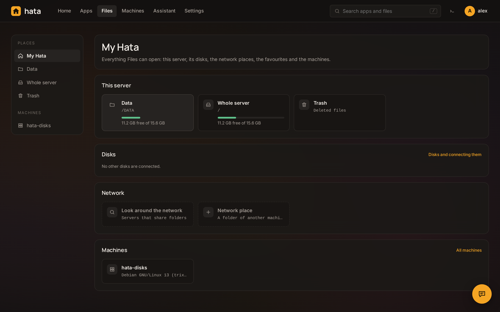 Моя хата: тека даних, диски, мережеві місця, обране й машини | 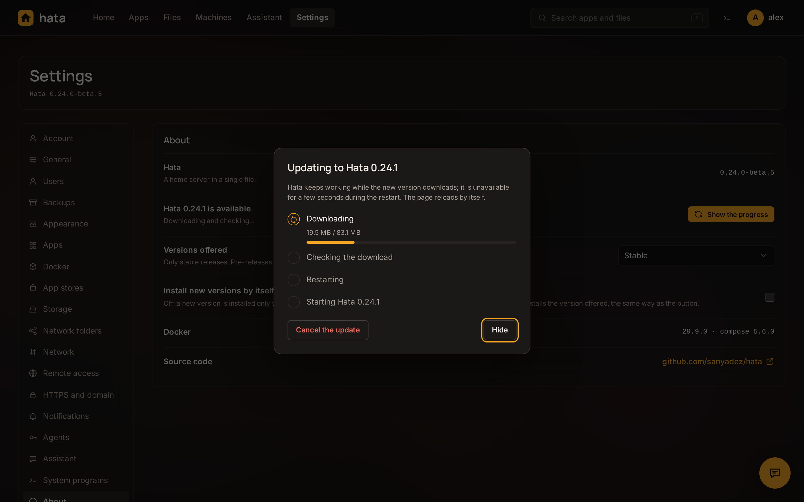 Оновлення Hata: кожен крок і скасування, доки нову версію не поставлено на місце |

### Інші машини

| | |
|---|---|
|  Машини: інші комп'ютери дому |  Машина: її стан одним поглядом |
|  Застосунки машини: встановлюються, оновлюються, копіюються й переносяться звідси |  Контейнери Docker на машині |
|  Термінал на машині |  Файли машини у Файлах |

### Proxmox VE

| | |
|---|---|
| 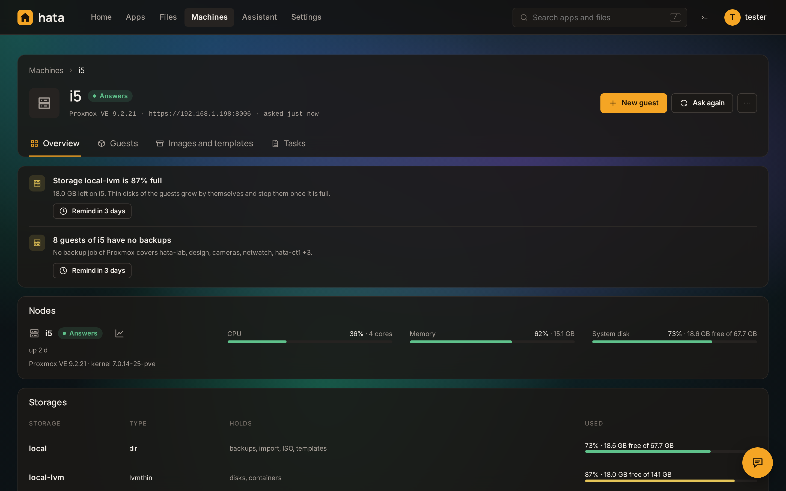 Сервер Proxmox: вузли, сховища, завдання копіювання, власний розклад Hata | 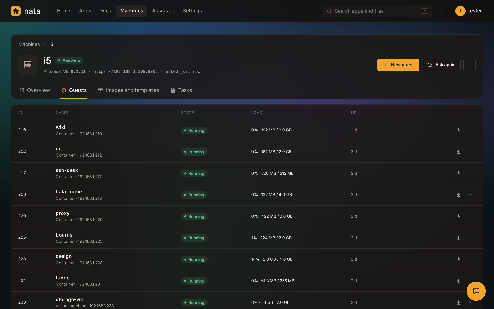 Його гості й те, що токен може зробити з кожним |
| 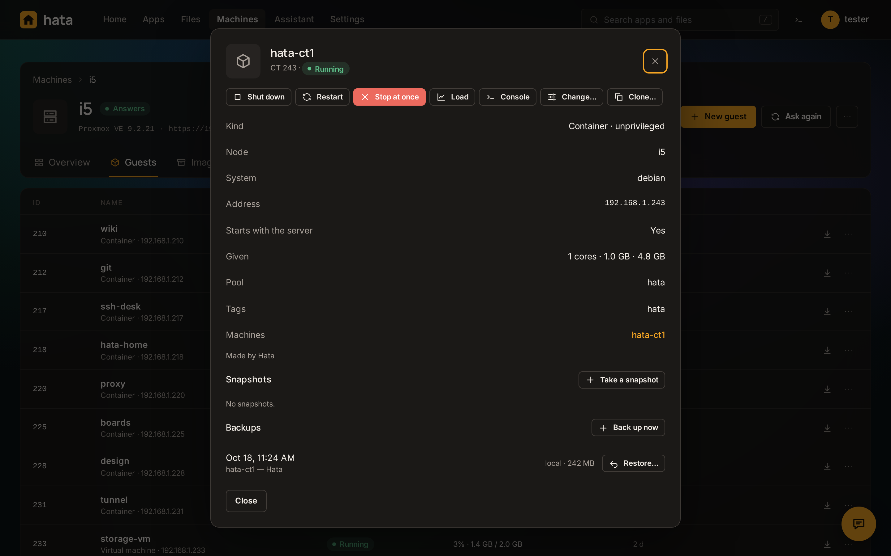 Гість: живлення, знімки, копії, налаштування, клонування | 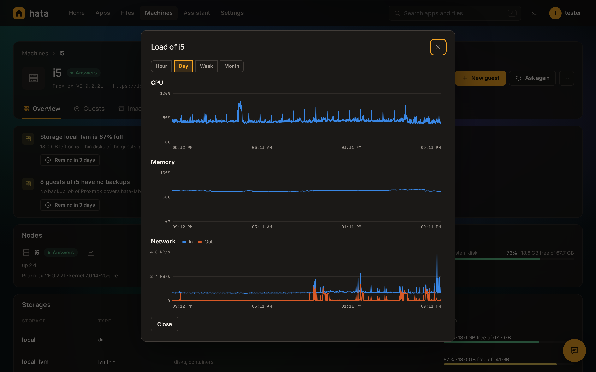 Навантаження вузла за день |
| 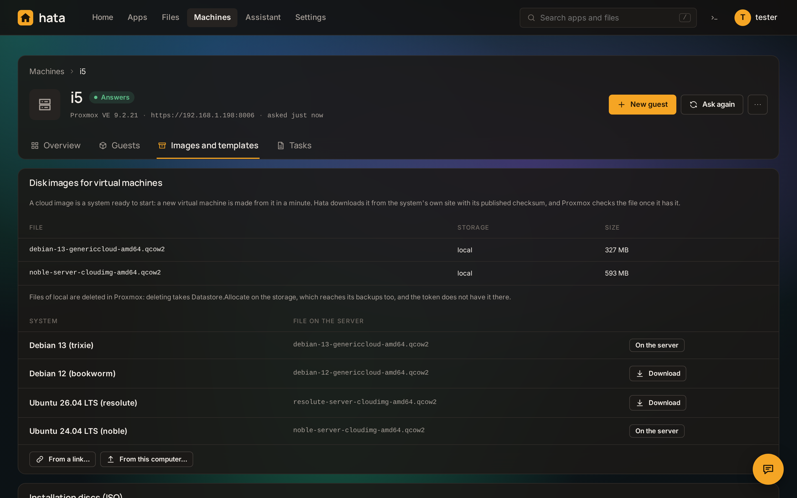 Шаблони, хмарні образи й інсталяційні диски | 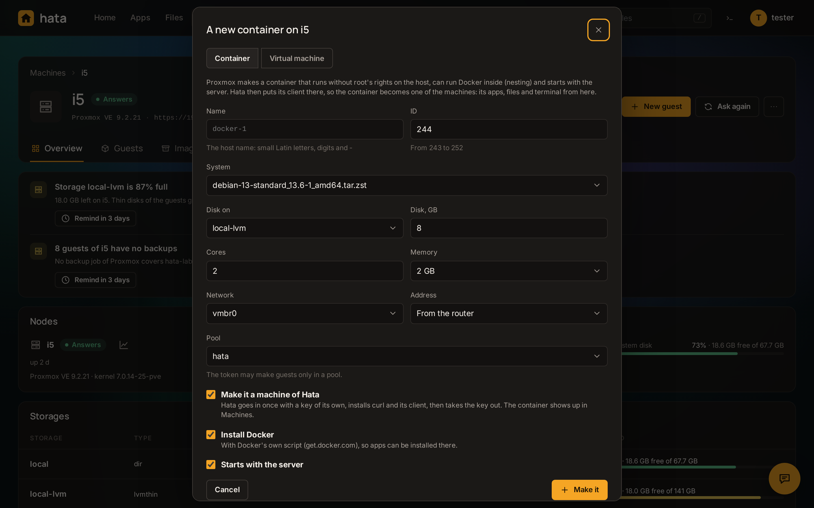 Новий контейнер чи віртуальна машина з клієнтом Hata всередині |

### Контейнери й віртуальні машини на сервері

| | |
|---|---|
| 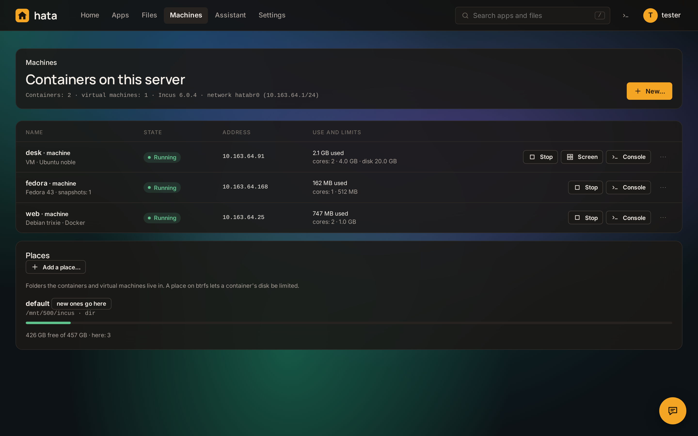 Контейнери й віртуальні машини цього сервера з їхніми обмеженнями й місцем, де вони живуть | 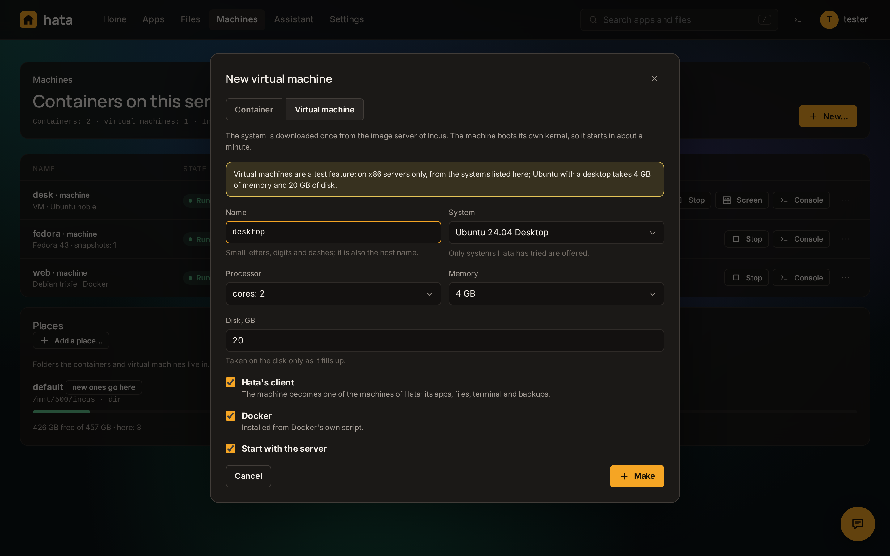 Нова віртуальна машина: Ubuntu з робочим столом |
| 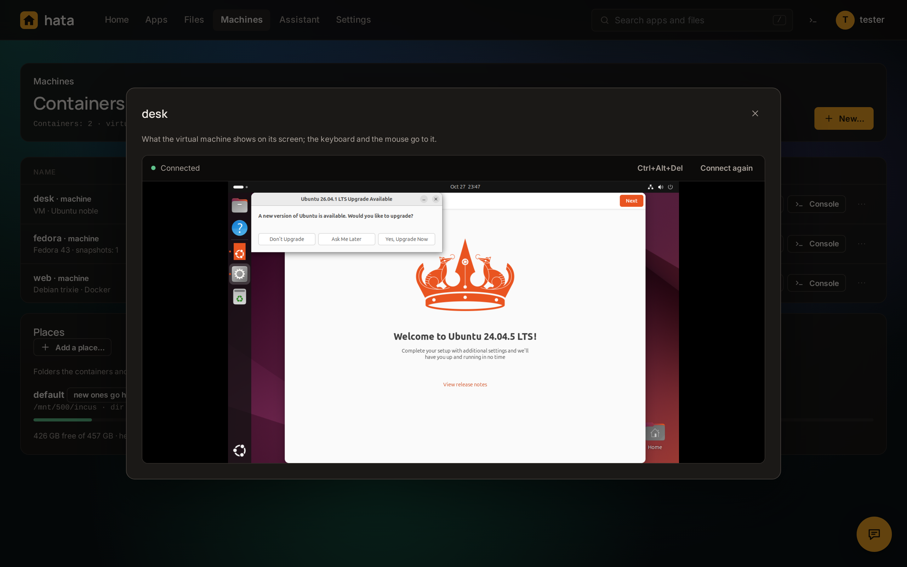 Екран віртуальної машини просто на сторінці | |

### Home Assistant

| | |
|---|---|
| 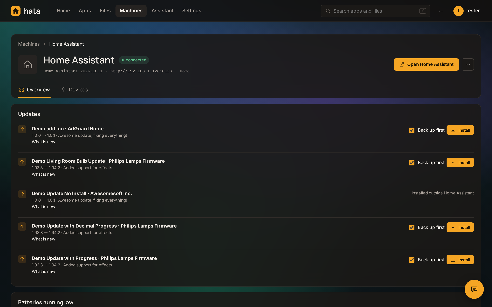 Сервер Home Assistant: його оновлення, копії й батареї | 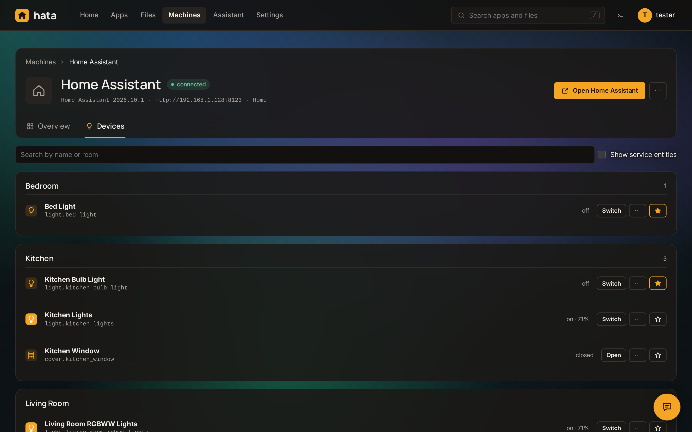 Його пристрої за кімнатами, зірочка виводить пристрій на головну |

### Перший запуск

| | | |
|---|---|---|
|  Назва сервера й часовий пояс |  Де лежать дані |  Кілька застосунків для початку |

### Налаштування

| | |
|---|---|
|  Обліковий запис: пароль, двофакторний вхід, ключі доступу, сеанси |  Загальні |
|  Вигляд |  Застосунки: тека даних і тека конфігурації |
|  Магазини застосунків |  Сховище: диски, файлові системи, що займає теку даних |
|  Мережеві теки (SMB) |  HTTPS і домен |
|  Сповіщення |  Агенти: ключі доступу до MCP-сервера |
|  Про систему й оновлення |  Мережа: інтерфейси, Wi-Fi, шляхи до інтернету |
|  Сховище: захист від відмови диска |  Віддалений доступ: Tailscale і WireGuard |
|  Помічник: з якою моделлю він говорить і що йому можна |  Системні програми: на що спирається Hata, і оновлення системи |
| 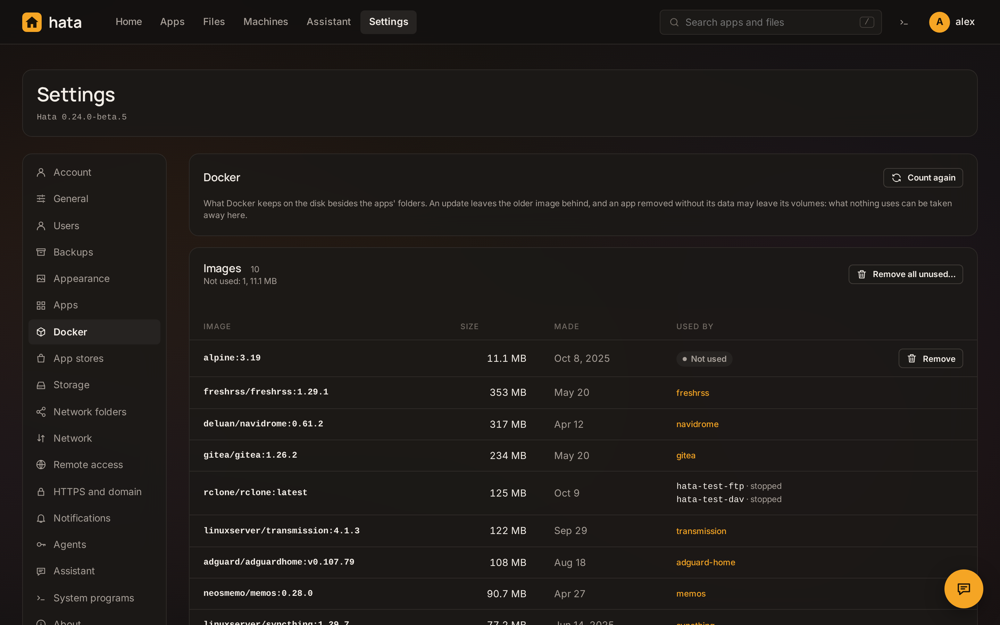 Docker: образи й томи, хто ними користується, що можна прибрати | 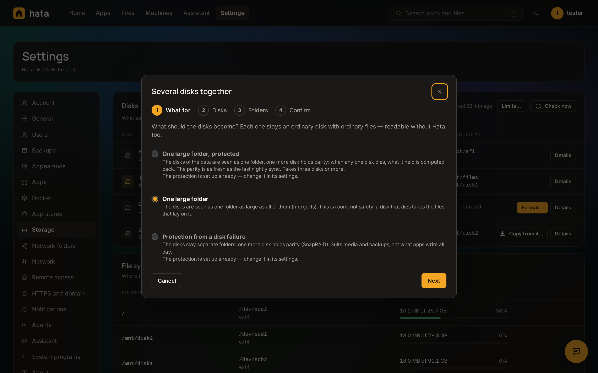 Кілька дисків разом: одна тека, захист, одне підтвердження |

### Вигляд

Вигляд задається в Налаштуваннях → Вигляд: колір акценту й колір тла (по вісім кожного або будь-який
власний; світле тло робить світлою всю сторінку) і фонове зображення — шість вбудованих або власне — із
серпанком поверх нього, який можна зробити світлішим чи темнішим.

Фонові зображення:

| | | |
|---|---|---|
|  Dusk |  Aurora, фіолетовий акцент |  Mist, зелений акцент |
|  Dunes, кораловий акцент |  Ocean, синій акцент |  Contours, лаймовий акцент |

Кольори тла й акценту:

| | | |
|---|---|---|
|  Власні кольори Hata |  Сланцевий, кораловий акцент |  Сосновий, рожевий акцент |
|  Сливовий, фіолетовий акцент |  Бордовий, синій акцент |  Чорний, блакитний акцент |
|  Світлий і теплий, зелений акцент |  Світлий і холодний, лаймовий акцент |  |

## Встановлення

На машині з Linux і systemd (x86_64 або arm64):

```sh
curl -fsSL https://raw.githubusercontent.com/sanyadez/hata/main/install.sh | sudo sh
```

Скрипт завантажує бінарний файл останнього випуску й звіряє його з контрольними сумами випуску,
встановлює Docker, якщо його немає, і запускає сервіс `hata`. Наприкінці він друкує адресу для створення
адміністратора. Щоб оновити, скористайтеся Налаштуваннями → Про систему у веб-інтерфейсі або запустіть
скрипт ще раз. Якщо порт 80 зайнятий, Hata бере наступний вільний і каже який; `--port <число>` задає порт.

Стан лежить у `/var/lib/hata` — це тека конфігурації; кожен застосунок — звичайний compose-проєкт у
`/var/lib/hata/apps/<назва>/`, який працює й без Hata. Теку можна перенести з Налаштувань → Застосунки
(скажімо, на інший диск): усе копіюється, Hata перезапускається вже там, застосунки працюють далі.
Те, що має лишатися приватним, — хеші паролів, сеанси, ключі сертифікатів, токени сповіщень — лежить
окремо в `/etc/hata` і з нею не переїжджає. Поруч із `compose.yml` застосунку, який ви редагуєте самі,
`hata.yml` тримає те, що про нього знає сама Hata, — магазин, з якого він узятий, і початковий файл із
магазину; `docker compose` його ніколи не читає.

### Переїзд із CasaOS

```sh
curl -fsSL https://raw.githubusercontent.com/sanyadez/hata/main/install.sh | sudo sh -s -- --migrate-casaos
```

Hata переймає застосунки, які встановила CasaOS, — ті самі compose-файли, ті самі контейнери, ті самі
дані в `/DATA`, — тоді зупиняє CasaOS і забирає порт 80. Контейнери під час переїзду не створюються
наново, і нічого з CasaOS не видаляється, тож усе можна повернути:

```sh
sudo hata migrate casaos --dry-run   # лише показати, що станеться
sudo hata migrate casaos --undo      # повернути застосунки CasaOS
```

Той самий переїзд можна зробити пізніше з веб-інтерфейсу (Застосунки → Імпорт), де пропонується й інше,
що працює на машині: compose-проєкти, запущені деінде, переймаються без перезапуску, а контейнери,
запущені без compose-файлу, — серед них і «legacy»-застосунки CasaOS — перебудовуються в застосунки на тих
самих томах і теках.

Не переноситься: власні налаштування й користувачі CasaOS.

### Команди

```
hata                    запустити сервер
hata install            встановити як сервіс systemd і запустити; --port <число>
hata uninstall          зупинити й прибрати сервіс (застосунки й дані лишаються)
hata restore <тека>     повернути сервер із теки копій: стан Hata, а тоді кожен застосунок
                        (або з s3://бакет/тека, sftp://користувач@хост/тека — друга копія)
hata unseal <файл.enc>  відкрити один файл зашифрованої копії
hata migrate casaos     перейняти застосунки встановленої CasaOS; --dry-run, --yes, --keep-casaos, --undo
hata setup-url          надрукувати адресу для створення першого адміністратора
hata version            надрукувати версію
```

`HATA_PORT`, `HATA_HOST` і `HATA_DATA_DIR` змінюють те, де сервер слухає і де тримає свій стан.

## Розробка

Потрібен лише [Bun](https://bun.com) 1.4 або новіший — встановлювати нічого не треба.

```sh
bun run dev      # запуск із вихідного коду з перезавантаженням, стан у ./data
bun test         # модульні тести
bun run build    # dist/hata-linux-x64 і dist/hata-linux-arm64
```

## Ліцензія

[PolyForm Noncommercial 1.0.0](LICENSE). Hata можна використовувати, змінювати й поширювати з будь-якою
некомерційною метою — вдома, для навчання, у некомерційній організації, — якщо кожна копія зберігає
ліцензію та примітку з іменем автора. Для комерційного використання потрібна окрема ліцензія від автора:
пишіть на <sanyadez@gmail.com>.

Версії до 0.1.0-alpha.3 випущено під ліцензією MIT. Шрифти в `src/ui/fonts` зберігають власну ліцензію
(SIL Open Font License).
